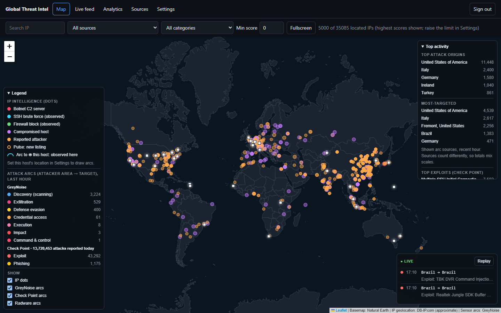
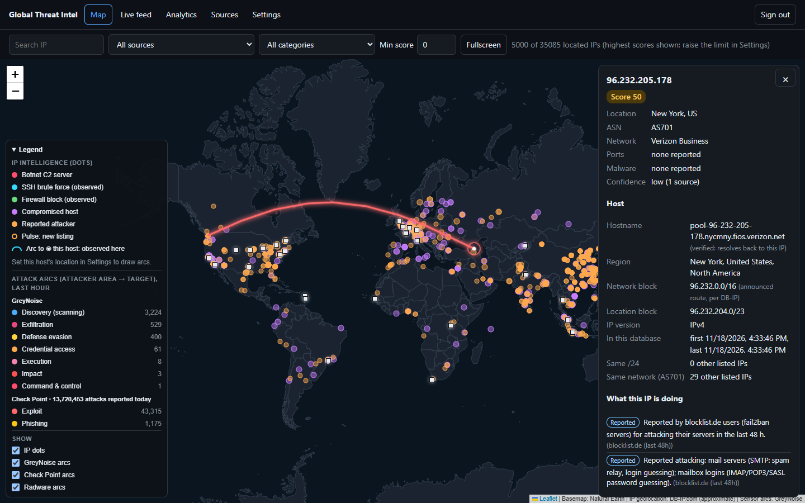
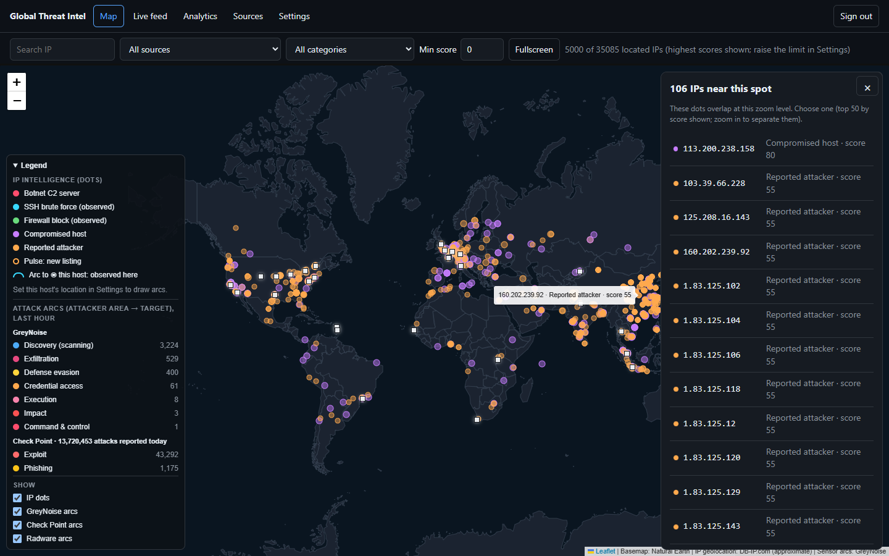
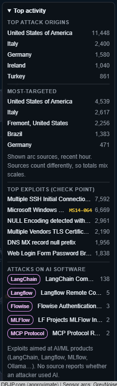
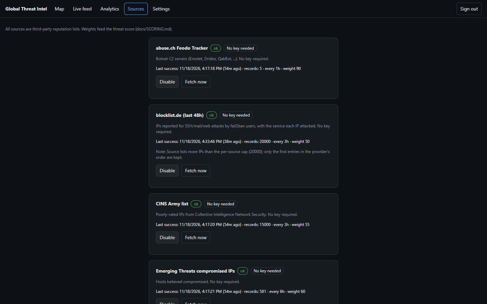
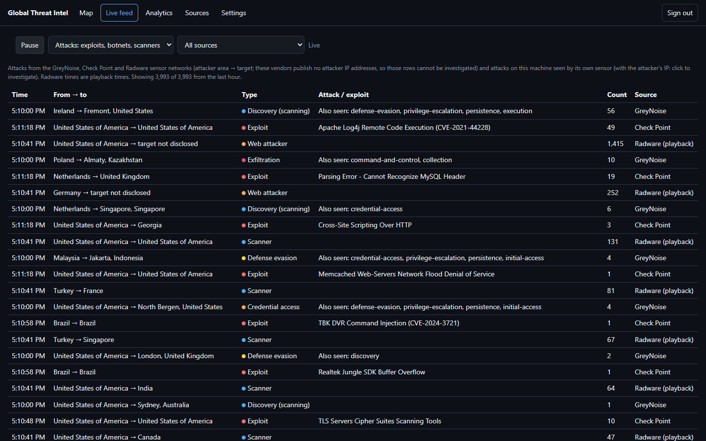
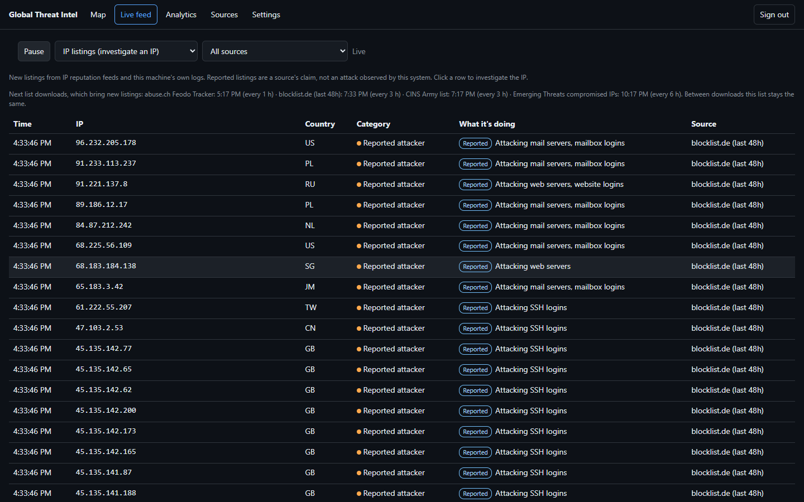
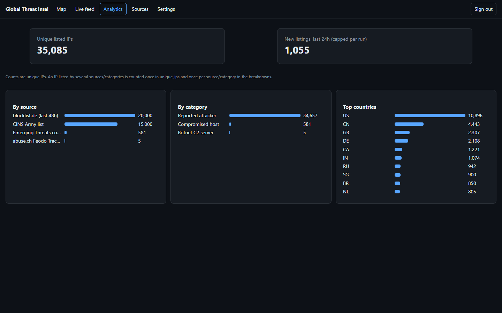

# Global Threat Intelligence Map

A self-hosted, live cyber-threat map and IP-intelligence dashboard. It runs on a Raspberry Pi 4/5 or any
Ubuntu Server 24.04+ machine (x86-64 or ARM64). You install it with one command, it needs no API keys,
and every item on screen says where it came from.



## What it does

- **Live attack map.** Animated arcs from attacker area to target, coloured by type and labelled in the
  legend:
  - GreyNoise's global sensor network, by MITRE ATT&CK tactic
  - Check Point ThreatCloud's live stream, with attack name and CVE
  - Radware's live threat map, by attack type
  - attacks seen by **this machine** (SSH login failures, firewall blocks)

  Each source has its own toggle.
- **IP intelligence.** About 35,000 malicious IPs from free reputation feeds, drawn as dots coloured by
  category: botnet C2, reported attacker, compromised host. A score combines how many sources list the IP and
  how recently.
- **Click any dot to investigate.** The panel shows:
  - **Host:** reverse DNS name (verified or not), region, network block, operator and network type, and how many
    other listed IPs share its /24 and its ASN
  - **What this IP is doing:** botnet C2 for a named malware family, which services it was reported attacking
    (SSH, mail, web logins, VoIP, ...), what it did to this machine, and what its ports are usually attacked for
  - **AbuseIPDB reports** (optional, with your free key): report categories, totals, network type and recent
    reporter notes
  - every source and how the score was calculated

  Where dots overlap, a click lists every IP at that spot.
- **Exploits and attacks on AI software.** The most-detected exploits with their CVEs, plus a separate list of
  exploits aimed at AI/ML software (LangChain, Langflow, Flowise, MLflow, Ollama, MCP servers, ...).
- **Live feed** in two views:
  - **IP listings:** every new malicious IP with what it is doing, e.g. "Attacking SSH logins, mail servers", "Botnet
    C2 server for QakBot", "Spam bot". Click a row to investigate the IP.
  - **Attacks:** every attack from the last hour, with exploits and CVEs, malware, botnets, scanners and MITRE
    tactics from the threat maps. Attacks on your own machine show the attacker's IP: click it to investigate.
    The vendor threat maps publish no attacker IPs, so their rows show the area only.
- **Live ticker** on the map, and an optional replay of recent history.
- **Honest data.** Each item is marked *observed* (seen by this machine) or *reported* (a third party's claim).
  Stale or failing sources are flagged and never shown as live. A blocklist entry is never presented as proof
  that an IP performed a specific attack.
- **Light enough for a Raspberry Pi.** One Python process and SQLite: no PostgreSQL, Redis or Node.js, no GPU.
  It measured 46 MB of RAM at steady state on the 4 GB profile.

## Screenshots

| IP details: host info and what the IP is doing | Overlapping dots: pick the IP |
|---|---|
|  |  |

| Top activity, exploits, AI-software attacks | Data sources (with the AbuseIPDB key field) |
|---|---|
|  |  |

| Live feed: attacks (exploits, malware, botnets, scanners) | Live feed: IP listings with what each IP is doing |
|---|---|
|  |  |

| Analytics | |
|---|---|
|  | |

## Data sources

| Source | What it adds | Key needed |
|---|---|---|
| abuse.ch Feodo Tracker | Botnet command-and-control servers, malware family, C2 port | no |
| blocklist.de | IPs reported by fail2ban users, with the service attacked (SSH, mail, web, FTP, SIP, ...) | no |
| CINS Army | Poorly rated IPs from the CINS sensor network | no |
| Emerging Threats | Compromised hosts | no |
| AbuseIPDB | High-confidence blacklist and per-IP report details | **yes** (free account) |
| GreyNoise threat map | Live sessions against GreyNoise honeypots, by MITRE tactic | no |
| Check Point threat map | Live stream of detections with attack name/CVE | no |
| Radware threat map | Attacks by type and country (a pre-scheduled playback, labelled as such) | no |
| Local sensor | SSH failures and UFW blocks against this machine (systemd journal) | no |
| DB-IP Lite | IP geolocation and ASN, refreshed monthly (CC BY 4.0) | no |

The GreyNoise, Check Point and Radware sources are the data behind those vendors' public threat-map pages, not
documented APIs. They carry no attacker IPs and can change without notice; if one breaks, it shows *error* and the
rest keeps working. See [docs/DATA-SOURCES.md](docs/DATA-SOURCES.md) for exactly what each source means.

## Requirements

| | Minimum | Recommended |
|---|---|---|
| OS | Ubuntu Server 24.04+ (x86-64 / ARM64) or Raspberry Pi OS 64-bit (bookworm or newer), with systemd | |
| Hardware | 2 GB RAM, 1.5 GB free disk | Raspberry Pi 5 / 4 with 4 GB+, or any small server; SSD rather than microSD |
| Python | 3.11 to 3.13 from the OS (the installer adds `python3-venv` if needed) | |
| Network | Outbound HTTPS to the feeds; about 200 MB/day download with every source on | |

**Tested status:** the installer, updates, rollback, backup/restore and uninstall were tested end to end on Ubuntu
24.04 x86-64. **Raspberry Pi and ARM64 are supported by design but have not been tested on hardware yet.** The
installer refuses 32-bit systems and systems without systemd. See [docs/TEST-REPORT.md](docs/TEST-REPORT.md).

## Install

### From this repository

```bash
git clone https://github.com/r00tb0ss/GlobalThreatMap.git
cd GlobalThreatMap
sudo ./install.sh
```

### From a release archive

```bash
sha256sum -c global-threat-intel-1.2.0.tar.gz.sha256
tar -xzf global-threat-intel-1.2.0.tar.gz
cd global-threat-intel-1.2.0
sudo ./install.sh
```

The installer checks the OS, CPU, Pi model, RAM, disk, port and internet connection. It then installs anything
missing, creates the `gti` service account, sets memory limits for your RAM, downloads the GeoIP databases,
starts the hardened systemd service and runs health checks. Finally it prints:

```
Dashboard:   http://192.168.1.50:8080
Setup token: (one-time token)
```

A failed step is named and rolled back, and the full log is kept in `/var/log/global-threat-intel/`.

Installer options:

| Option | Effect |
|---|---|
| `--port N` | Dashboard port (default 8080) |
| `--local-only` | Listen on 127.0.0.1 only (no LAN access) |
| `--offline` | Install only from files in the package (use the `-offline` release archive) |
| `--yes` | Non-interactive |
| `--repair` | Reinstall the application files of an existing install (config and data are kept) |
| `--force` | Continue on an untested OS or low memory |

### Offline install

No internet on the target machine? Build or download `global-threat-intel-<version>-offline.tar.gz`, which bundles
the Python wheels for x86-64 and ARM64 and the GeoIP data, then run `sudo ./install.sh --offline`. To build the
archives yourself on Linux: `scripts/build-release.sh`. They are written to `dist/`, with SHA-256 checksums.

## First-time setup

1. Open the dashboard URL from another device on your network.
2. Enter the **setup token** printed by the installer. You can show it again with `sudo gti setup-token`.
3. Create your administrator account: choose a username and a password of 12 characters or more. There are no
   default credentials.
4. You land on **Sources**. The free sources are already on and fill the map within a few minutes.
5. Optional: paste a free [AbuseIPDB](https://www.abuseipdb.com/register) API key into the AbuseIPDB card, then
   click **Save key** and **Enable**. This adds the AbuseIPDB blacklist and per-IP report details in the IP panel.
   The key is stored on the server only and never sent to the browser.
6. Optional: under **Settings**, set this machine's location so attacks it observes draw arcs to it, and choose
   how long history is kept.

## Using the map

- **Click a dot** to open its IP details. If several dots overlap, choose from the list. You can also click a
  row in the ticker or the live feed.
- **Search** an IP or filter by source, category and minimum score above the map.
- **Legend (bottom left):** colours for every dot category and attack type, with counts for the last hour, and
  checkboxes to show or hide each source.
- **Top activity (top right):** top attack origins and targets, top exploits with CVEs, and attacks on AI
  software in the last hour.
- **Ticker (bottom right):** live arrivals. **Replay** loops recent recorded data and says so while it runs.

## Everyday commands

| Task | Command |
|---|---|
| Health check | `sudo gti health` |
| Backup now | `sudo gti backup` (daily automatic backups, 7 kept) |
| Restore | `sudo gti restore /var/backups/global-threat-intel/<file>.tar.gz` |
| Update | `sudo gti update <release.tar.gz>` (backs up first, rolls back on failure) |
| Logs | `sudo gti logs` |
| Forgot password | `sudo gti reset-password <user>` |
| Uninstall, keep data | `sudo gti uninstall` |
| Uninstall everything | `sudo gti uninstall --complete` (a final backup is kept) |

## Security

- **No default credentials:** the administrator is created with a one-time setup token.
- **Passwords and sessions:** scrypt password hashing, HttpOnly SameSite=Strict session cookies, CSRF tokens and
  origin checks, and login throttling.
- **Database:** no exposed database ports. SQLite lives under `/var/lib/global-threat-intel`.
- **Service sandbox:** runs as an unprivileged user under systemd with a read-only system, no capabilities and a
  syscall filter.
- **Strict content security policy:** the browser makes no third-party requests, and the map and libraries are
  bundled.
- **Network exposure:** the installer does not open firewall ports. Allow your LAN only, and use a VPN or an HTTPS
  reverse proxy for remote access. Don't forward the port on your router.

Details: [docs/SECURITY.md](docs/SECURITY.md).

## How it works

```
 feeds / vendor maps / journald ──► collector (scheduled, sequential) ──► SQLite (WAL)
                                                │                            │
                                                └── WebSocket push ──► browser ◄── REST API (FastAPI)
```

- **Backend:** Python, FastAPI and Uvicorn. Dependencies are hash-pinned and installed from wheels only, so
  nothing is compiled on the Pi.
- **Frontend:** plain JavaScript with Leaflet 1.9.4 and a bundled Natural Earth basemap. No build step, CDN or
  tile server.
- **Layout:**
  - `/opt/global-threat-intel/releases/<version>`, with a `current` link for atomic updates
  - `/etc/global-threat-intel/gti.env`
  - `/var/lib/global-threat-intel`
  - `/var/backups/global-threat-intel`

## Development

```bash
python3 -m venv .venv && .venv/bin/pip install --require-hashes -r requirements/requirements.lock
.venv/bin/pip install pytest httpx
cd backend && ../.venv/bin/python -m pytest -q        # 88 tests
python scripts/dev-run.py                              # dashboard on http://127.0.0.1:8088, data in .devdata/
```

The dev server reads the GeoIP databases from `geoip/` (not in the repository: about 190 MB). Download them with
`scripts/update-geoip.sh --python .venv/bin/python --dest geoip`.

## Documentation

- [docs/INSTALL.md](docs/INSTALL.md): requirements, Raspberry Pi notes, ports, firewall, LAN access
- [docs/DATA-SOURCES.md](docs/DATA-SOURCES.md): every source, the IP panel fields, exploits and AI-software attacks
- [docs/SCORING.md](docs/SCORING.md): how scores and confidence are calculated
- [docs/OPERATIONS.md](docs/OPERATIONS.md): updates, backup/restore, uninstall, configuration
- [docs/SECURITY.md](docs/SECURITY.md): security model
- [docs/TROUBLESHOOTING.md](docs/TROUBLESHOOTING.md)
- [docs/TEST-REPORT.md](docs/TEST-REPORT.md): what was tested, on what, and what was not

## Licence and attributions

Licensed under the GNU General Public License v2.0 (see [LICENSE](LICENSE)).

Bundled and used data and code: [Leaflet](https://leafletjs.com) (BSD-2-Clause),
[Natural Earth](https://www.naturalearthdata.com) (public domain), and IP geolocation by
[DB-IP](https://db-ip.com) (CC BY 4.0). Threat data belongs to its providers: abuse.ch, blocklist.de, CINS,
Proofpoint Emerging Threats, AbuseIPDB, GreyNoise, Check Point and Radware. Follow each provider's terms of use.
